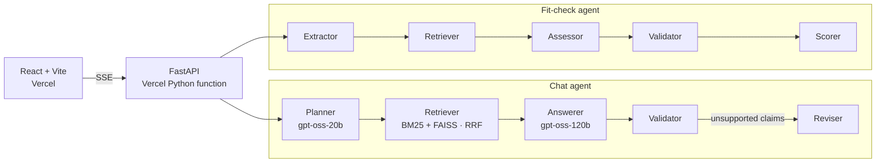

# Ask Devraj — an AI agent that answers questions about me

A portfolio site where recruiters can **ask anything about my experience** or **paste a job description to get an honest fit check**. They can watch the multi-agent pipeline that answers them work live.

It uses the same pattern I build in production: role-based agents over a RAG pipeline, with a validation agent that fact-checks answers before they're shown.

## What it does

- **Ask anything.** Answers are grounded in my resume and project notes, with inline citations `[1]` you can hover to see the source.
- **Fit check for recruiters.** Paste a JD. The agent extracts the requirements, finds evidence for each, rates it *match / partial / gap*, and gives a weighted fit score. Gaps are shown honestly.
- **Live agent trace.** Every step streams to the UI: the planner's intent and search queries, retrieved passages with similarity scores, timings, and the validator's verdict.
- **Self-correcting.** If the Validator finds a claim the sources don't support, a Reviser rewrites the answer, and the UI says so.

## Architecture



| Layer | Choice | Why |
| --- | --- | --- |
| Orchestration | LangGraph `StateGraph` | Explicit, testable agent steps; custom stream mode feeds the live trace |
| Retrieval | BM25 + FAISS over model2vec embeddings (potion-base-8M, int8, bundled), fused with Reciprocal Rank Fusion | Keyword precision for tool names (e.g. "SageMaker") plus semantic recall; an 8 MB static model keeps cold starts fast on serverless |
| LLMs | Groq: gpt-oss-120b (answers, checks), gpt-oss-20b (planning) | Open-weight, fast, free tier; automatic fallback to 20B if 120B is rate-limited |
| Guardrails | Grounding prompt, validator + reviser, deterministic checks (a "match" must cite evidence), per-IP rate limits | No invented experience |
| Streaming | Server-Sent Events over POST | Tokens and trace events arrive as they happen |

## Run locally

**Backend** (Python 3.12, [uv](https://docs.astral.sh/uv/)):

```bash
cd backend
cp .env.example .env          # add GROQ_API_KEY (free at console.groq.com/keys)
uv sync
uv run uvicorn app.main:app --reload --port 8000
uv run pytest                 # tests use scripted fake LLMs, no key needed
```

**Frontend** (Node 20+):

```bash
cd frontend
cp .env.example .env.local    # VITE_API_URL=http://localhost:8000
npm install
npm run dev                   # http://localhost:5173
```

## Deploy (free, Vercel)

Two Vercel projects from this one repo:

1. **API:** import the repo, set the root directory to `backend`, and add the env vars `GROQ_API_KEY` and `ALLOWED_ORIGINS=https://<your-site>.vercel.app`. `api/index.py` serves the FastAPI app as a Python function.
2. **Site:** import the repo again, set the root directory to `frontend` (Vite is auto-detected), and add `VITE_API_URL=https://<your-api>.vercel.app`.

The `backend/Dockerfile` also runs the API on any container host.

## Updating what the agent knows

Edit the Markdown files in `backend/knowledge/`. Each `##` section becomes one retrievable chunk. The `url:` line links citations to a section of the site. Restart the backend to re-index.
